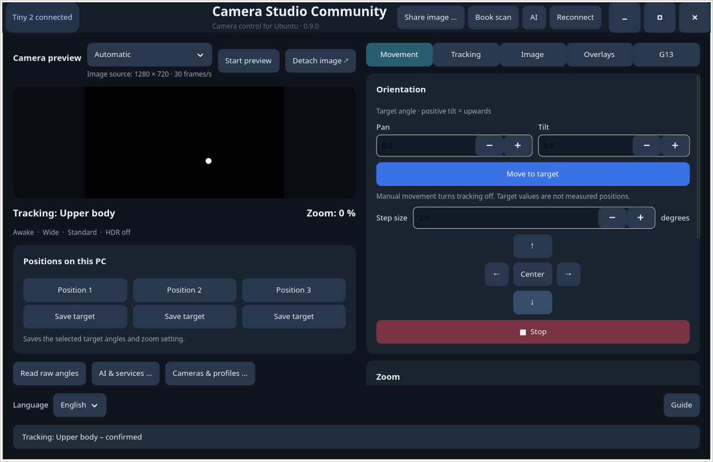

# Camera Studio Community

A native GTK 4 camera studio for Ubuntu, with built-in **OBSBOT Tiny 2** controls, additional camera profiles, independent preview windows, book scanning and optional image AI.

**User guides:** [English](docs/guide-en.md) · [Deutsch](docs/guide-de.md) · [Dansk](docs/guide-da.md) · [Español](docs/guide-es.md) · [Polski](docs/guide-pl.md) · [Français](docs/guide-fr.md)



This is an independent community application, not an OBSBOT, AmScope or Andonstar product. It has a separate launcher and configuration from Tiny 2 Studio. No Windows installer, firmware, proprietary camera SDK, AI model or user credentials are included.

## Features and boundaries

| Area | Available | Limitations |
| --- | --- | --- |
| Tiny 2 | Pan/tilt, zoom, tracking modes, image controls, local target presets | Target angles are not measured physical positions; mechanical precision unverified |
| Additional cameras | Linux/UVC and declarative USB profiles; independent windows | A JSON profile cannot implement a proprietary protocol |
| AmScope/MU300 | Optional adapter to an existing Linux AmLite SDK | SDK not bundled; capture size negotiated |
| Andonstar | Optional LiveView MJPEG over connected camera Wi-Fi; digital zoom | No automatic Wi-Fi changes; no microscope focus control |
| Capture size | Enumerated resolutions, formats, frame rates and supported size ranges | Window size and sensor capture size are different |
| Image tools | Text/clock/image overlays, clipboard, PNG, mouse/tablet drawing | No virtual-camera output, beauty filters or background replacement |
| Books | Reviewable page capture, corner correction, local OCR, PDF/EPUB | Bundled OCR: German and English only |
| AI | Local Ollama, OpenAI (ChatGPT), xAI (Grok), Google Gemini | User-configured vision model and API access; cloud requests may cost money |
| Language | English, German, Danish, Spanish, Polish, French; offline guides | Restart to apply language; external tools keep their own interface |
| Input | Mouse, pen and optional compatible Logitech G13 service | No G13 driver/profile installation |

## Install or remove

Requirements: Python 3.10+, GTK 4.8+, GStreamer and Tesseract 5. The GitHub CI workflow targets Ubuntu 24.04. Download the DEB from the repository's Releases when a release is published, then run from its folder:

```sh
sudo apt install ./camera-studio-community_0.9.0_all.deb
camera-studio-community
```

For a source checkout or ZIP, install the dependencies below and run `./Starten.sh`. Select language at the bottom of the main window and restart. The Guide button opens the bundled HTML manual. `--language fr` selects a language for one launch.

```sh
sudo apt remove camera-studio-community
```

Removal preserves personal settings and book projects. Tiny 2 Studio is unaffected. Details are in the translated guides.

## Development and verification

Use the distribution's Python so that its GTK bindings are available:

```sh
sudo apt install python3 python3-gi python3-cairo python3-gi-cairo python3-pil libtesseract5 gir1.2-gtk-4.0 gir1.2-gdkpixbuf-2.0 gir1.2-pango-1.0 gir1.2-gstreamer-1.0 gstreamer1.0-plugins-base gstreamer1.0-plugins-good
/usr/bin/python3 -B -m unittest discover -s tests -p 'test_*.py'
/usr/bin/python3 -B build.py
```

The build produces a DEB, complete source ZIP and SHA-256 checksums in `dist/`. It regenerates offline guides and excludes Git metadata, caches and user configuration. Build dependencies are `dpkg-deb` and the Python standard library. GUI tests also use a display or Xvfb; fake SDK tests need a C compiler. See [CONTRIBUTING](CONTRIBUTING.md).

Automated tests cover all six catalogs, placeholder integrity, language persistence, unchanged camera protocol identifiers, synthetic camera control and translated GTK windows. Cloud tests use simulated replies. No live cloud account access, model permissions, full camera compatibility or mechanical precision is certified. [Test record](TESTERGEBNIS.txt).

## Privacy and optional integrations

Camera controls, drawing, book storage and OCR work locally. Selecting an AI provider sends nothing. Send transfers one selected image and up to eight text messages from that provider's own conversation. Histories are separate and held in memory. AI output remains a suggestion. Dictation uses a separately installed local Whisper model.

Keys are session-only by default; optional persistence is plaintext with owner-only permissions. Never commit keys, images, book projects or settings. [Full data-flow and key instructions](docs/guide-en.md). Comic issue OCR uses a separately configured compatible cover tool, independently of AI; it does not automatically book stock.

## Contributing and licensing

Camera profiles, reproducible bug reports and translation improvements are welcome. See [contribution instructions](CONTRIBUTING.md), [release notes](CHANGELOG.md) and [security reporting](SECURITY.md).

Application code and documentation: [MIT](LICENSE). Bundled Tesseract language data: Apache-2.0. See [third-party notices and source provenance](THIRD_PARTY_NOTICES.md) before redistributing. The detailed protocol research record is in [SOURCES.txt](SOURCES.txt).
